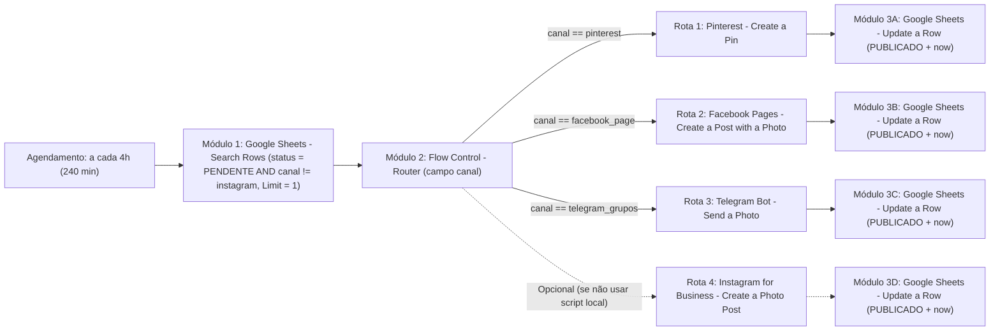
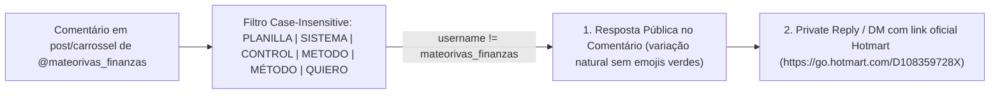

# Guia de Automação e Blueprint Make.com — FINANZASPRO

Este documento especifica a arquitetura completa do cenário único no **Make.com** integrado ao **Google Sheets** para distribuir conteúdo orgânico em espanhol neutro (Colômbia, México, Espanha e LATAM) nos canais **Pinterest**, **Facebook Page**, **Telegram (grupos externos via repasse manual em 15s)** e **Instagram Business** (via script local `instagram_publisher.py` com **0 operações** no Make, ou opcionalmente como 4ª rota no Make), mantendo consumo confortável dentro do **plano gratuito de 1.000 operações/mês**.

> **Identidade visual FINANZASPRO (criativos futuros):** `#0A192F` (navy base), `#112240` (cards), `#3B82F6` (accent azul), `#FFFFFF` (títulos), `#E2E8F0` (texto secundário) — **zero verde** (inclusive evitar emojis verdes nas legendas e templates).

---

## 1. Arquitetura do Cenário Único e Orçamento de Operações



### Cálculo Exato de Consumo (Plano Gratuito: 1.000 ops/mês)

| Item | Cálculo | Operações |
|---|---|---|
| Módulo 1 (`Search Rows`) | 1 execução por ciclo | **1 op** |
| Módulo 2 (`Router`) | Routers não consomem operação no Make | **0 ops** |
| Módulo de Publicação (apenas 1 rota dispara por ciclo) | Pinterest OU Facebook OU Telegram | **1 op** |
| Módulo 3 (`Update a Row` no fim da rota ativa) | Atualiza `status` e `data_hora` | **1 op** |
| **Total por publicação concluída** | **1 + 0 + 1 + 1** | **3 ops/ciclo** |
| **Consumo diário (a cada 4 horas = 6 ciclos/dia)** | `6 × 3` | **18 ops/dia** |
| **Consumo mensal (mês de 30 dias)** | `180 × 3` | **540 ops/mês** |
| **Consumo mensal (mês de 31 dias)** | `186 × 3` | **558 ops/mês** |
| **Folga no Plano Gratuito (1.000 ops/mês)** | `1.000 - 558` | **442 ops livres (~44%)** |

- **Quando a fila ficar vazia (0 linhas `PENDENTE`):** o Módulo 1 consome apenas **1 op** e encerra o ciclo sem disparar o Router.
- **Dica opcional de economia extra:** em *Schedule Settings > Advanced*, se você pausar a janela da madrugada (ex.: 01:00–05:00), o consumo cai para ~**450 ops/mês** e evita envios fora do horário nobre LATAM/Espanha.

---

## 2. Inventário Real de `./ativos/` e Hospedagem (Storage)

Arquivos reais encontrados na pasta `./ativos/` durante a auditoria:

| Arquivo real em `./ativos/` | Tamanho | Classificação | URL codificada (RFC 3986) usada no CSV | Observação técnica |
|---|---:|---|---|---|
| `capa  reel terça.png` | 5,34 MB | Imagem pronta (9:16) | `https://SEU_STORAGE/ativos/capa%20%20reel%20ter%C3%A7a.png` | **ATENÇÃO:** possui **2 espaços** entre `capa` e `reel` e pesa **5,34 MB** (acima do limite de 5 MB do Telegram via URL). Usada apenas em `pinterest` e `facebook_page`. Recomenda-se comprimir para < 1,5 MB antes de usar no Telegram. |
| `CAPA E-BOOK.jpeg` | 107 KB | Imagem pronta (vertical) | `https://SEU_STORAGE/ativos/CAPA%20E-BOOK.jpeg` | Possui um pequeno botão `X` de modal no topo central (captura de tela). Pode ser recortado depois para acabamento mais limpo. |
| `demonstração planilha - ingresos.jpeg` | 168 KB | Imagem pronta (16:9) | `https://SEU_STORAGE/ativos/demonstra%C3%A7%C3%A3o%20planilha%20-%20ingresos.jpeg` | Aba `Ingresos` do FinanzasPro v2.0. |
| `demonstração planilha - presupuesto.jpeg` | 205 KB | Imagem pronta (16:9) | `https://SEU_STORAGE/ativos/demonstra%C3%A7%C3%A3o%20planilha%20-%20presupuesto.jpeg` | Aba `Presupuesto` (Regra 50/30/20 + limites por categoria). |
| `demonstração planilha - resumen anual.jpeg` | 149 KB | Imagem pronta (16:9) | `https://SEU_STORAGE/ativos/demonstra%C3%A7%C3%A3o%20planilha%20-%20resumen%20anual.jpeg` | Aba `Resumen Anual 2026` (evolução dos 12 meses). |
| `demonstração planilha - vision geral.jpeg` | 159 KB | Imagem pronta (16:9) | `https://SEU_STORAGE/ativos/demonstra%C3%A7%C3%A3o%20planilha%20-%20vision%20geral.jpeg` | Dashboard `Visión General` completo (Saldo, Dívida, Metas, Gráficos). |
| `persona - mateo rivas referencia visual.jpg` | 125 KB | Imagem pronta (16:9) | `https://SEU_STORAGE/ativos/persona%20-%20mateo%20rivas%20referencia%20visual.jpg` | Close de Mateo Rivas no estúdio com logo FinanzasPro. |
| `persona - mateo rivas referencia visual corpo.jpg` | 109 KB | Referência interna | *(não mapeada no lote)* | Contém barras laterais cinzas de folha de referência; manter apenas para geração de criativos ou recortar antes de publicar. |
| `Video Planilha demonstração.mp4` | 21,49 MB | Vídeo (excluído) | *(não mapeado)* | Módulos de Pin de imagem e Photo Post não aceitam `.mp4`. |
| `Intel-Driver-and-Support-Assistant-Installer.exe` | 8,72 MB | Instalador avulso | *(excluir da pasta)* | **Remova este `.exe` de `./ativos/`** antes de subir a pasta para qualquer storage público. |

### Como hospedar `./ativos/` gratuitamente (HTTPS público direto)

As APIs do Pinterest, Facebook e Telegram exigem uma **URL HTTPS direta que retorne o arquivo de imagem** (`Content-Type: image/jpeg` ou `image/png`) — links de visualização do Google Drive (`/file/d/.../view`) frequentemente falham.

Opções gratuitas recomendadas:
1. **Projeto Vercel existente (`finanzasprooficial.vercel.app`) — mais simples:** copie apenas as imagens para `public/ativos/` no repositório da landing page e faça deploy. As imagens ficarão acessíveis em `https://finanzasprooficial.vercel.app/ativos/...`.
2. **Cloudflare R2 (bucket público com domínio `r2.dev`):** 10 GB grátis/mês e zero custo de tráfego (egress).
3. **Supabase Storage (bucket público `ativos`):** URL HTTPS direta estável.

> **Importante sobre espaços e acentos (`ç`, `ã`):** no `historico_grupos.csv` todas as URLs já estão pré-codificadas em RFC 3986 (`%20`, `%C3%A7`, `%C3%A3`) correspondendo exatamente aos nomes atuais dos arquivos em `./ativos/`. Depois de subir as imagens, abra o Google Sheets, pressione `Ctrl + H` e substitua `https://SEU_STORAGE` pelo seu domínio real (ex.: `https://finanzasprooficial.vercel.app`). Se no futuro preferir renomear os arquivos para slugs sem acento (ex.: `planilha-presupuesto.jpeg`), atualize a coluna `imagem_url` de acordo.

---

## 3. Preparação da Planilha no Google Sheets

1. Crie uma nova planilha no Google Sheets (ex.: `FINANZASPRO - Fila Organica Make`).
2. Renomeie a aba principal para **`fila_publicacao`**.
3. Vá em **Arquivo > Importar > Fazer upload** e envie `historico_grupos.csv`.
4. Nas opções de importação:
   - Local de importação: **Substituir página atual**
   - Tipo de separador: **Vírgula** (o Google Sheets detecta UTF-8 automaticamente)
   - Converter texto em números, datas e fórmulas: **Não** (evita alterações indesejadas em IDs ou URLs).
5. Confira se o cabeçalho nas colunas `A1:I1` está exatamente assim:
   `id` | `data_hora` | `canal` | `angulo` | `titulo` | `copy` | `imagem_url` | `link_hotmart` | `status`
6. Faça `Ctrl + H` na coluna `imagem_url` para trocar `https://SEU_STORAGE` pela URL real do seu storage.

---

## 4. Configuração Exata Módulo a Módulo no Make.com

Crie um novo cenário em **Scenarios > Create a new scenario** com o nome `FINANZASPRO - Distribuicao Organica 4h`.

### Agendamento (Relógio no Módulo 1)
- Clique no ícone de relógio no primeiro módulo.
- **Run scenario:** `At regular intervals`
- **Minutes:** `240` (a cada 4 horas)
- Deixe a chave de agendamento **OFF** até concluir o teste do item 5.

---

### Módulo 1 — `Google Sheets > Search Rows`

| Campo | Valor exato |
|---|---|
| **Connection** | Sua conta Google conectada |
| **Search Method** | `Search by path` ou `Select from all` |
| **Spreadsheet ID** | `FINANZASPRO - Fila Organica Make` |
| **Sheet Name** | `fila_publicacao` |
| **Table contains headers** | `Yes` (`A1:Z1`) |
| **Filter 1 — Column** | `status (I)` |
| **Filter 1 — Operator** | `Text operators: Equal to` |
| **Filter 1 — Value** | `PENDENTE` |
| **Filter 2 (AND) — Column** | `canal (C)` *(Obrigatório se publicar Instagram via script local)* |
| **Filter 2 — Operator** | `Text operators: Not equal to` |
| **Filter 2 — Value** | `instagram` |
| **Sort order** | `Ascending` (mantém fila FIFO: `FP-001`, `FP-002`, ...) |

> **Aviso crítico de coexistência (Make.com + `instagram_publisher.py`):** se você importar o `historico_grupos.csv` completo (que contém linhas `canal = instagram`) na aba `fila_publicacao` do Google Sheets e publicar o Instagram pelo script Python local, adicione o **Filter 2 (`canal != instagram`)** no Módulo 1 do Make. Caso contrário, o Make lerá uma linha `instagram`, não encontrará rota correspondente no Router (se não tiver a Rota 4) e nunca atualizará o status, travando a fila FIFO.
| **Order by** | `Row number` |
| **Maximum number of returned rows** | **`1`** *(CRÍTICO: garante apenas 1 post por execução)* |

---

### Módulo 2 — `Flow Control > Router`

Conecte um módulo **Router** (`Flow Control > Router`) logo após o Módulo 1 e puxe **3 ramos** a partir dele. Em cada ramo, clique na **chave inglesa (Set up a filter)** na linha pontilhada entre o Router e o módulo do canal.

---

#### Rota 1 — Pinterest (`canal == pinterest`)

1. **Filtro na linha do Router:**
   - **Label:** `Rota Pinterest`
   - **Condition:** `{{1.canal}}` → `Text operators: Equal to (case insensitive)` → `pinterest`
2. **Módulo 2A — `Pinterest > Create a Pin`:**

| Campo | Mapeamento / Valor |
|---|---|
| **Connection** | Conta Pinterest Business do FINANZASPRO |
| **Board** | Selecione o Board alvo (ex.: `Finanzas Personales \| FinanzasPro`) |
| **Media source type** | `Image URL` |
| **Image URL** | `{{1.imagem_url}}` |
| **Title** | `{{1.titulo}}` *(limite API: 100 caracteres)* |
| **Description** | `{{1.copy}}` *(limite API: 500 caracteres)* |
| **Link** | `{{1.link_hotmart}}` *(receberá `https://go.hotmart.com/D108359728X`)* |
| **Alt text** *(opcional)* | `{{1.titulo}} - FinanzasPro` |

3. **Módulo 3A — `Google Sheets > Update a Row`:** conecte logo após o Módulo 2A (configuração na seção abaixo).

---

#### Rota 2 — Facebook Page (`canal == facebook_page`)

1. **Filtro na linha do Router:**
   - **Label:** `Rota Facebook Page`
   - **Condition:** `{{1.canal}}` → `Text operators: Equal to (case insensitive)` → `facebook_page`
2. **Módulo 2B — `Facebook Pages > Create a Post with a Photo`:**

| Campo | Mapeamento / Valor |
|---|---|
| **Connection** | Conta Facebook com permissão de Administrador da Página |
| **Page** | Página oficial do FINANZASPRO |
| **Upload method / Photo URL** | `URL` → `{{1.imagem_url}}` *(prefira o campo URL direto; só adicione `HTTP > Get a File` antes se a versão do módulo exigir upload binário, pois isso consumiria +1 op nessa rota)* |
| **Message (Description)** | Ver template abaixo |

Template exato do campo **Message**:
```text
{{1.copy}}

👇 {{1.link_hotmart}}
```
*(Receberá `https://finanzasprooficial.vercel.app/?utm_source=organico_make` com UTM pronta para medir o tráfego orgânico da automação.)*

3. **Módulo 3B — `Google Sheets > Update a Row`:** conecte logo após o Módulo 2B (configuração na seção abaixo).

---

#### Rota 3 — Telegram Grupos (`canal == telegram_grupos`)

**Pré-requisito rápido (2 minutos):**
1. No Telegram, abra `@BotFather`, envie `/newbot`, escolha nome e username e copie o **API Token**.
2. Abra o chat com o seu novo bot e clique em **Iniciar (`/start`)** (obrigatório para o bot poder te enviar mensagens).
3. Descubra seu **Chat ID pessoal** enviando qualquer mensagem para `@userinfobot` (ou acessando `https://api.telegram.org/bot<SEU_TOKEN>/getUpdates`).

1. **Filtro na linha do Router:**
   - **Label:** `Rota Telegram Grupos`
   - **Condition:** `{{1.canal}}` → `Text operators: Equal to (case insensitive)` → `telegram_grupos`
2. **Módulo 2C — `Telegram Bot > Send a Photo`:**

| Campo | Mapeamento / Valor |
|---|---|
| **Connection** | Token do seu bot criado no `@BotFather` |
| **Chat ID** | Seu `Chat ID` pessoal (número inteiro) |
| **Photo (Data / URL)** | Marque modo URL / informe `{{1.imagem_url}}` |
| **Parse Mode** | `HTML` *(mais seguro que Markdown, pois `_` em URLs com UTM não quebra a formatação)* |
| **Caption** | Ver template abaixo *(limite rígido da API do Telegram: **1.024 caracteres**)* |

Template exato do campo **Caption** (HTML):
```html
<b>{{1.titulo}}</b>

{{1.copy}}

👇 {{1.link_hotmart}}
```

> **Rotina operacional de 15 segundos nos grupos públicos externos:**
> 1. Quando o bot entregar a foto + legenda formatada no seu chat privado, clique em **Encaminhar** no Telegram.
> 2. Antes de enviar, toque no topo da prévia e marque **Ocultar nome do remetente** (*Hide sender's name*) — assim a postagem entra limpa nos grupos públicos, sem rótulo de "Encaminhada de Bot".
> 3. Selecione 2 a 4 grupos públicos de finanças/poupança LATAM/Espanha e envie.

3. **Módulo 3C — `Google Sheets > Update a Row`:** conecte logo após o Módulo 2C (configuração na seção abaixo).

---

#### Canal 4 — Instagram Business (`canal == instagram`) — 2 Modos de Operação

##### Grade Diária Oficial (`@mateorivas_finanzas` — Horário de Brasília / `America/Sao_Paulo`)
- **14h30 — Reel (Topo de Funil):** alcance e descoberta de novos seguidores.
- **18h30 — Carrossel 6 Slides (Meio de Funil):** conteúdo analítico + prova da planilha + gatilho de comentário para DM (`PLANILLA`, `SISTEMA`, `CONTROL`, `METODO`, `QUIERO`).

A API do Instagram exige estritamente **imagem JPEG (`image/jpeg`, sRGB, ≤ 8 MB)** com proporção entre **4:5 (`0.80`) e `1.91:1`** em URL HTTPS pública direta. Arquivos `.png` ou `9:16` retornam HTTP 400.

##### Modo A (Recomendado): Script Local `instagram_publisher.py` (0 operações no Make.com)

Usa o arquivo `.env` local (ignorado pelo `.gitignore`), a fila `historico_grupos.csv` e as imagens JPEG 4:5 geradas em `ativos_instagram/` hospedadas no GitHub (`https://raw.githubusercontent.com/mateusbatistucci01-source/finanzaspro-ativos/main/ativos_instagram/...`). Suporta tanto **imagem única** quanto **carrosséis de 2 a 10 slides**.

1. **Conta configurada automaticamente no `.env`:**
   - Conta conectada: **`@mateorivas_finanzas`** (`IG_USER_ID=17841466115419627`), descoberta automaticamente via `GET /v22.0/me/assigned_instagram_accounts` (ou `graph.instagram.com/v22.0/me` para tokens Unified Login `IGAA...`).
2. **Como publicar Carrosséis (2 a 10 slides):**
   - Coloque os slides PNG/JPG dentro de uma subpasta em `ativos_anuncios/` (ex.: `ativos_anuncios/carrossel_01/slide_01.png` ... `slide_05.png`) e rode `python instagram_publisher.py --prepare-images`.
   - O script converte todos os slides para `1080x1350` sRGB JPEG com fundo `#0A192F` em `ativos_instagram/carrossel_01/` e imprime a string pronta separada por `;` para colar na coluna `imagem_url` do `historico_grupos.csv` (também aceita `|` ou o caminho da pasta `ativos_instagram/carrossel_01`).
   - Ao publicar (`--publish`), o script cria cada item com `is_carousel_item=true`, aguarda `status_code=FINISHED` em todos, cria o container pai com `media_type=CAROUSEL` + `children` + `caption`, aguarda `FINISHED` e finaliza em `/media_publish`.
3. **Comandos exatos no terminal:**
   ```bash
   # 1) Converter criativos PNG e subpastas de carrossel para JPEG 4:5 (1080x1350) em ativos_instagram/
   python instagram_publisher.py --prepare-images

   # 2) Validar token Meta, IG_USER_ID (@mateorivas_finanzas), permissões e URLs pendentes no GitHub
   python instagram_publisher.py --check

   # 3) Simular o próximo post (single ou carrossel) da fila sem publicar (dry-run)
   python instagram_publisher.py --dry-run

   # 4) Publicar 1 post pendente no Instagram e marcar PUBLICADO no CSV
   python instagram_publisher.py --publish --limit 1
   ```
   *(Lembre-se de rodar `git add ativos_instagram/ && git commit && git push` sempre que gerar novas imagens/carrosséis para que as URLs raw do GitHub respondam `200 OK`.)*

---

#### Funil Automático Comentário → DM no Instagram (Multi-Palavras-Chave)

O token do System User já possui as permissões `instagram_manage_comments` e `instagram_manage_messages` ativas para `@mateorivas_finanzas` (`IG_USER_ID=17841466115419627`). Isso permite automatizar o funil completo **Comentário → Resposta Pública + Direct com link Hotmart** no Make.com (ou via Webhook oficial da Meta):



##### 1. Palavras-chave oficiais e filtro (Make.com)
Crie um cenário dedicado no Make (`FINANZASPRO - Instagram Comentario para DM`):
- **Gatilho (Módulo 1):** `Instagram for Business > Watch Comments` (ou `Webhooks > Custom Webhook` assinado no campo `comments` do App Meta) apontando para `@mateorivas_finanzas`.
- **Filtro entre Módulo 1 e Módulo 2:**
  - **Condição 1 (anti-loop):** `{{1.from.username}}` → `Text operators: Not equal to (case insensitive)` → `mateorivas_finanzas`
  - **Condição 2 (multi-palavras-chave case-insensitive):** `{{1.text}}` → `Text operators: Matches pattern (case insensitive)` → `\b(planilla|sistema|control|m[eé]todo|quiero)\b`
  - *(Alternativa sem regex: 6 condições `OR` com `Contains (case insensitive)` para `PLANILLA`, `SISTEMA`, `CONTROL`, `METODO`, `MÉTODO` e `QUIERO`.)*

##### 2. Ação 1 — Resposta Pública no Comentário (com variação natural)
- **Módulo 2:** `Instagram for Business > Create a Comment Reply` (ou `HTTP > Make a request` para `POST https://graph.facebook.com/v22.0/{{1.id}}/replies`).
- Para evitar respostas idênticas repetitivas, use `get(split(...))` ou um módulo `Tools > Set variable` alternando entre 3 variações neutras (sem emojis verdes) baseadas em `{{(parseNumber(formatDate(now; "s")) % 3) + 1}}`:
  1. `¡Listo! Acabo de enviarte el acceso por mensaje privado. Revisa tu bandeja de solicitudes si no aparece de inmediato.`
  2. `Enviado por DM. Mira tus mensajes privados que ahí tienes el enlace directo.`
  3. `Te lo acabo de mandar por mensaje privado. Cualquier duda sobre cómo usar el planificador, me escribes por ahí.`

##### 3. Ação 2 — Envio do Link no Direct (Private Reply oficial)
- **Módulo 3:** `HTTP > Make a request` (API oficial de **Private Replies** da Meta, que permite responder por DM a qualquer comentário nos últimos 7 dias mesmo sem conversa prévia):
  - **URL:** `https://graph.facebook.com/v22.0/17841466115419627/messages`
  - **Method:** `POST`
  - **Headers:** `Authorization: Bearer {{SEU_IG_ACCESS_TOKEN}}` e `Content-Type: application/json`
  - **Body (JSON):**
    ```json
    {
      "recipient": {
        "comment_id": "{{1.id}}"
      },
      "message": {
        "text": "¡Hola! Aquí tienes el acceso directo a FinanzasPro en Google Sheets (haces una copia privada en tu propia cuenta, sin fórmulas ni conocimientos previos):\n\n👇 https://go.hotmart.com/D108359728X\n\nSi tienes alguna duda sobre las pestañas o los planes disponibles, respóndeme por aquí mismo."
      }
    }
    ```
- **Consumo no Make.com:** este cenário usa Webhook/Watch (1 op no disparo + 1 op na resposta pública + 1 op no envio de DM = **3 ops por lead qualificado**). Como só dispara quando alguém comenta uma das palavras-chave, o consumo escala apenas com demanda real.

##### Modo B (Opcional): Rota 4 no Make.com (`Instagram for Business`)

Se preferir unificar tudo no cenário do Make (mantendo 3 ops por ciclo ativo = 540–558 ops/mês), remova o Filtro 2 (`canal != instagram`) do Módulo 1 e adicione uma 4ª rota no Router:

1. **Filtro na linha do Router:**
   - **Label:** `Rota Instagram`
   - **Condition:** `{{1.canal}}` → `Text operators: Equal to (case insensitive)` → `instagram`
2. **Módulo 2D — `Instagram for Business > Create a Photo Post`:**
   - **Page / Instagram Account:** Conta Instagram Business do FINANZASPRO
   - **Photo URL:** `{{1.imagem_url}}` *(deve apontar para `.jpg`/`.jpeg` em `ativos_instagram/`)*
   - **Caption:** `{{1.copy}}` *(já inclui CTA para o link na bio e hashtags; limite API: 2.200 chars)*
3. **Módulo 3D — `Google Sheets > Update a Row`:** conecte logo após o Módulo 2D.

---

### Módulo 3 (3A, 3B e 3C — ao final de CADA rota) — `Google Sheets > Update a Row`

Adicione um módulo `Google Sheets > Update a Row` no final de **cada uma das 3 rotas** (3A após Pinterest, 3B após Facebook, 3C após Telegram). Dessa forma, a linha **só é marcada como `PUBLICADO` se a entrega no canal ocorrer com sucesso**.

| Campo | Mapeamento / Valor |
|---|---|
| **Connection / Spreadsheet / Sheet** | Mesma planilha e aba `fila_publicacao` do Módulo 1 |
| **Row number** | `{{1.__ROW_NUMBER__}}` *(selecione a pílula **Row number** retornada pelo Módulo 1)* |
| **Values — `data_hora` (B)** | `{{now}}` *(ou, se preferir data legível no fuso desejado: `{{formatDate(now; "YYYY-MM-DD HH:mm:ss"; "America/Sao_Paulo")}}`)* |
| **Values — `status` (I)** | `PUBLICADO` |
| **Demais colunas (`id`, `canal`, `angulo`, `titulo`, `copy`, `imagem_url`, `link_hotmart`)** | **Deixe em branco** *(no Make, campos vazios preservam o valor já gravado na célula)* |

---

## 5. Checklist de Testes e Troubleshooting

### Procedimento de Teste Seguro (`Run once`)
1. Verifique se as URLs em `imagem_url` já foram atualizadas com seu storage real e abrem diretamente em uma aba anônima do navegador.
2. Clique em **Run once** no Make.com — ele processará `FP-001` (`pinterest`).
   - Confirme: Pin criado no Board correto com imagem, título, descrição e link Hotmart + linha 2 da planilha alterada para `PUBLICADO` com timestamp em `data_hora`.
3. Clique em **Run once** uma 2ª vez — ele processará `FP-002` (`facebook_page`).
   - Confirme: Post com foto publicado na Página com link da landing page + linha 3 alterada para `PUBLICADO`.
4. Clique em **Run once** uma 3ª vez — ele processará `FP-003` (`telegram_grupos`).
   - Confirme: Foto + legenda em negrito/HTML recebida no seu chat privado + linha 4 alterada para `PUBLICADO`.
5. Somente após validar as 3 rotas, salve o cenário (`Ctrl + S`) e ligue **Scheduling: ON** (a cada 4 horas).

### Mapa Rápido de Erros Comuns

| Erro / Sintoma | Causa provável | Correção imediata |
|---|---|---|
| `400 Bad Request` / `Invalid image URL` | Espaços ou acentos sem codificação na URL, ou link de visualização do Google Drive | Use HTTPS direto de Vercel/R2/Supabase e garanta URL codificada (`%20`, `%C3%A7`, `%C3%A3`). |
| Telegram: `wrong file identifier/HTTP URL specified` ou erro de tamanho | Imagem maior que **5 MB** via URL (caso de `capa  reel terça.png`, que pesa 5,34 MB) | Comprima a imagem para < 1,5 MB antes de usá-la na rota `telegram_grupos`. |
| Telegram: `message caption is too long` | `titulo` + `copy` + `link_hotmart` passou de **1.024 caracteres** | Mantenha o combinado abaixo de 900 caracteres (regra já automatizada no `/gerar-lote-finanzas`). |
| Pinterest: `400` em Title ou Description | `titulo` > 100 chars ou `copy` > 500 chars | Respeite `titulo` ≤ 85 chars e `copy` ≤ 450 chars. |
| Instagram: `400` em `/media` (`image_url` ou aspect ratio) | Imagem em `.png`, proporção fora de `4:5`..`1.91:1`, > 8 MB ou URL 404 (sem `git push`) | Rode `python instagram_publisher.py --prepare-images` (gera JPEG 4:5 em `ativos_instagram/`), faça `git push` e valide com `--check`. |
| Instagram: `IG_USER_ID` não encontrado automaticamente | Token de System User sem `pages_show_list` | Preencha `IG_USER_ID=` no `.env` copiando o ID no Meta Business Suite (*Configurações do Negócio > Contas > Contas do Instagram*). |
| Make publicou todas as linhas de uma vez | `Maximum number of returned rows` no Módulo 1 não estava em `1` | Edite o Módulo 1 e fixe **Limit = `1`**. |
| `data_hora` sobrescreveu outras colunas | Espaços acidentais nos campos vazios do Módulo 3 | Limpe todos os campos do Módulo 3 exceto `Row number`, `data_hora` e `status`. |

---

## 6. Rotina Contínua de Abastecimento

Com 6 publicações/dia (a cada 4h), cada lote de **12 entradas dura exatamente 48 horas (2 dias)**. Sempre que restarem poucas linhas `PENDENTE`, execute o comando `/gerar-lote-finanzas` (definido em `.agent/workflows/gerar-lote-finanzas.md`) para gerar 12 novas entradas inéditas sem repetir ganchos e cole as 12 novas linhas no final da aba `fila_publicacao` no Google Sheets.
